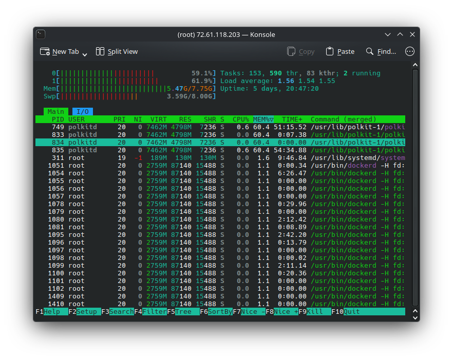
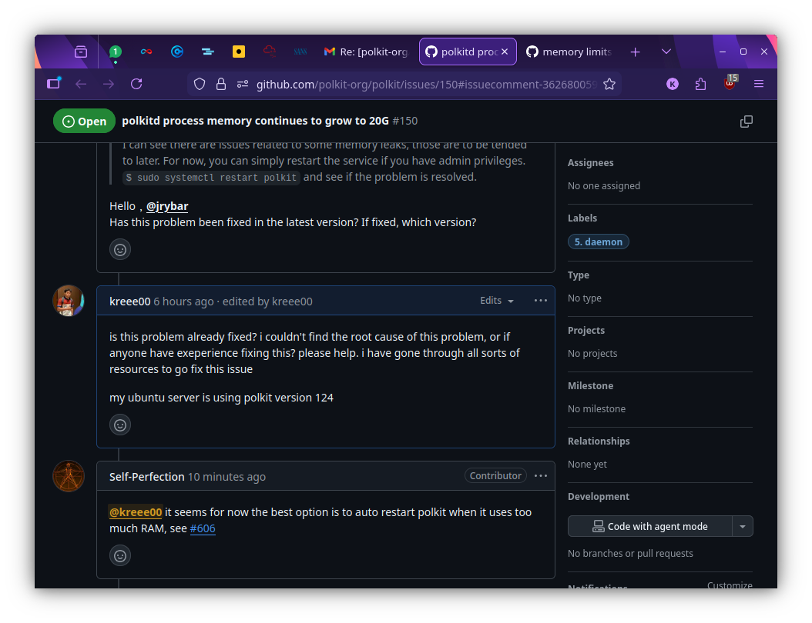

In the world of server maintenance, few things are as terrifying as opening htop and seeing red bars everywhere.

Recently, I ran into a critical issue on one of our Virtual Private Servers (VPS). The server was becoming sluggish, and services were timing out. When I investigated, I found that a single process was eating up almost 100% of both our RAM and our Swap memory.

The culprit? polkitd (The PolicyKit Daemon).

This is the story of how I went from manual server restarts to engineering a fully automated, fail-safe memory management solution.

## 🚨 The Incident: When 4GB Isn't Enough

It started with a simple observation: the server was running out of breath.

My first reaction was standard triage. I assumed we were simply under-provisioned or experiencing a temporary spike. I added an additional 4GB of Swap file (bringing the total memory cushion to 8GB) hoping that would give the server enough breathing room to stabilize.

I restarted the service manually to flush the memory:

```bash
sudo systemctl restart polkitd
```


The memory usage dropped. The red bars in htop turned green. I thought the job was done.



But a few days later, the creep started again. It wasn't a sudden spike; it was a slow, consistent memory leak. The daemon was hoarding memory and refusing to let it go, eventually threatening to crash the entire node.

## 🕵️ The Investigation

As a Computer Science student and DevOps enthusiast, I knew that constantly restarting a service manually wasn't a "solution"—it was a chore. I needed to understand the why.

I dove into the internet. I scoured forums, StackOverflow, and eventually landed on the official polkit source repository.



I wasn't alone. I found threads of other sysadmins complaining about the exact same behavior. When I asked in the community if there was a patch available, the answer was disheartening: "Up until now, there is still no fix."

I was at a crossroads. I couldn't fix the C code in polkitd overnight, and I couldn't wait for an upstream patch while my production server risked downtime.

## 🛠️ The Solution: If You Can't Fix It, Manage It

If I couldn't stop the leak, I had to contain it. I decided to build a "governor" for the process—an automated system that watches polkitd and restarts it gracefully before it becomes a problem.

I designed a two-layer defense system.

#### Layer 1: The Smart Hook (EarlyOOM)

For the primary defense, I utilized earlyoom, a daemon usually used to kill processes when memory is critically low. However, I didn't want to wait until the server was crashing to take action.

I wrote a custom Bash hook script that:
- Identifies the polkitd process ID.
- Reads the specific memory usage from /proc/[pid]/status.
- Calculates its consumption percentage against the total available RAM.
- Triggers a graceful systemctl restart if it exceeds a 12% threshold.

This ensures the service is refreshed without forcefully killing it, maintaining system stability.

#### Layer 2: The Fail-Safe (Systemd Resource Control)

Scripts can fail. Cron jobs can hang. As a DevOps engineer, you always need a backup plan. I needed a hard ceiling that the operating system would enforce, regardless of whether my script was running.

I used systemd's built-in resource control to set a hard limit on the service. I applied this using the following command:

```bash
sudo systemctl set-property polkit.service MemoryMax=1500M
```


This command modifies the service unit configuration on the fly. Now, if my hook script fails to catch the leak and `polkitd` balloons past 1.5GB, `systemd` will step in and throttle or restart the process to save the rest of the system (and my Docker containers) from crashing.

#### 🚀 The Result

I deployed the solution on a Monday. Since then, I haven't had to SSH into the server to clear memory once.

- Before: Daily manual checks, fear of crashes, 100% swap usage.
- After: The hook script runs silently in the background, keeping polkitd lean, and the server metrics are stable.

I packaged this entire solution, including the detection logic, the hook scripts, and the installation steps—into an open-source tool so others facing this specific bug can implement a fix in minutes.

Check out the repo here:
👉 [github.com/kreee00/polkitd-memory-manager](github.com/kreee00/polkitd-memory-manager)

🧠 Lessons Learned

This project reinforced a few key DevOps philosophies for me:

1. Don't wait for upstream: Sometimes the "official fix" is months away. You have to build the bridge yourself.
2. Observability is key: Without tools like htop and understanding how to read /proc files, I would have just kept buying more RAM.
3. Automation > Manual Intervention: If you have to do it twice, script it. If it keeps breaking, automate the fix.

Dealing with memory leaks is never fun, but turning a system instability into a reliable, automated, "set-it-and-forget-it" solution was a massive win.

Thanks for reading my blog post :)